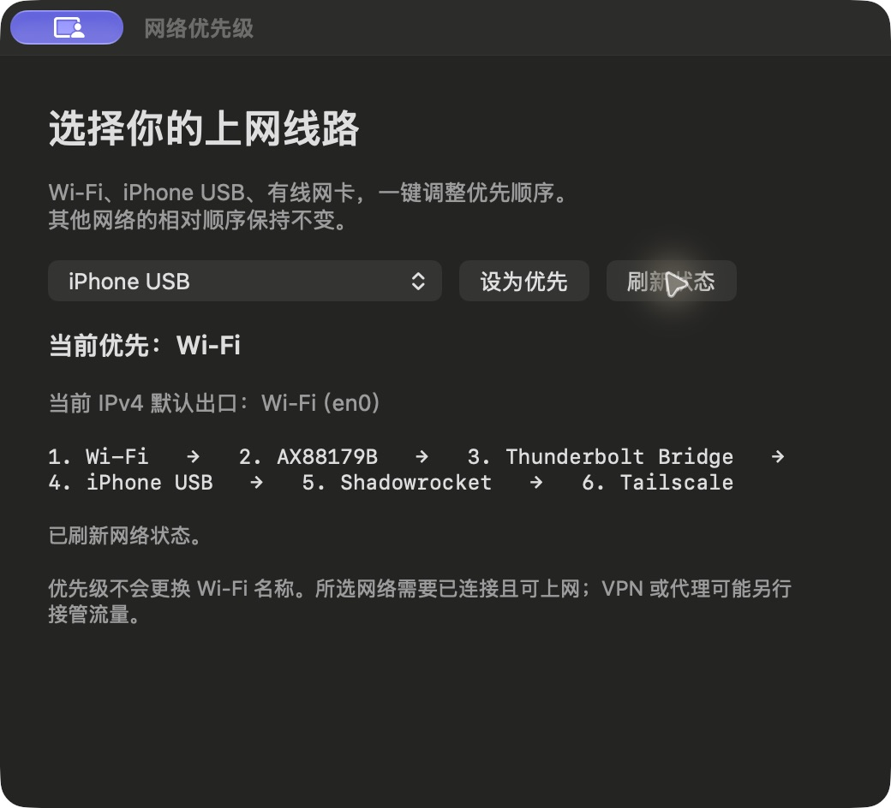

# 网络优先级 · Network Priority


**让 Mac 的网卡排好队，别再集体抢方向盘。**

一个小小的 macOS 原生工具：选择 Wi-Fi、iPhone USB 或有线网卡，点击「设为优先」，把它放到网络服务队伍最前面。其他服务保持原有相对顺序。

比如调试路由器时，Wi-Fi 负责连接设备后台，iPhone USB 负责上网。两份工作，两条线路，谁也别抢谁的工位。



## 下载与安装

前往 **[最新版本下载](https://github.com/zhengsaihong/network-priority/releases/latest)**。

1. 下载 `NetworkPriority-1.0.0-universal.dmg`，双击打开。
2. 把「网络优先级」拖到旁边的 `Applications` 文件夹。
3. 在「应用程序」中打开它，给网卡们排个座次。

也提供 ZIP：解压后将应用拖进「应用程序」即可。安装不会自动修改网络顺序，只有点击「设为优先」才会修改。

目标系统为 **macOS 13 及以上**，安装包包含 Apple Silicon 和 Intel 两种架构。已在 Apple Silicon Mac 上验证；Intel 仅完成交叉编译，未进行真机运行测试，也未逐一测试所有 macOS 版本。

### 第一次打开遇到系统提示？

发布版使用作者的**个人 Apple Development 证书**签名，没有使用公司证书，也没有进行 Apple 公证。它不是经过公证的 Developer ID 分发应用，因此其他 Mac 下载后可能被 Gatekeeper 拦截。

确认下载来源后，可在系统提供该选项时通过右键「打开」，或「系统设置 → 隐私与安全性 → 仍要打开」处理。不同 macOS 版本的提示与可用选项可能不同；不保证所有机器都能直接放行。请不要为了这个小工具关闭整个系统的安全检查，也可以选择下方的本机源码编译。

## 怎么用

1. 先把要使用的网络连接好。
2. 从下拉框选中网络服务，点击 **设为优先**。
3. 查看「当前优先」和「当前 IPv4 默认出口」；有变化时点击「刷新状态」。

服务顺序修改后会重新读取核验，错误会显示在窗口里。设置由 macOS 保存，关闭应用不会撤销；想换回来，就把原来的网络重新设为优先。注意：这不是恢复完整历史顺序的「撤销」按钮。

**排第一 ≠ 一定能上网。** 网线没插、热点没开时，它不会凭空给你变出一根网线。VPN、代理和 IPv6 也可能另有安排。优先级是排队规则，默认出口才是当前 IPv4 路由的观察结果；工具本身不检测互联网连通性。

## 它管什么，不管什么

- 调整 macOS 网络服务的优先顺序，显示当前 IPv4 默认出口。
- 不切换 Wi-Fi 名称，不改 IP、DNS、网关、代理或路由器配置。
- 不启用被停用的网络服务，不接管 VPN，不保证所有流量走同一线路。
- 不保存密码、不上传数据、不安装后台常驻服务。
- 不能把百兆路由器劝成万兆。这个得靠预算，不能靠按钮。

底层调用系统自带的 `networksetup` 和 `route`，按当前用户权限执行。受管理的 Mac 或权限不足的账户可能被系统拒绝，应用会显示错误，不会偷偷提权。

## 自己编译

需要 macOS、Swift 6 或更新版本，以及提供该工具链的 Xcode / Command Line Tools。

```sh
git clone https://github.com/zhengsaihong/network-priority.git
cd network-priority
zsh build.sh
```

默认输出到 `~/Applications/网络优先级.app`，生成通用二进制，并使用本地 ad-hoc 签名（不需要开发者证书）。

可指定输出目录或自己的签名证书：

```sh
OUTPUT_DIR="$PWD/output" zsh build.sh
SIGNING_IDENTITY='你的证书 SHA-1 指纹' zsh build.sh
```

`release.sh` 是作者的发布脚本，固定核验作者的个人证书，找不到就停止，不会自动换用其他证书。其他开发者发布前须改成自己的证书指纹和签名名称。运行后在 `dist/` 生成 DMG、ZIP 和 `SHA256SUMS.txt`。证书私钥不在仓库和安装包中。

下载三个发布文件到同一目录后，可核对校验和：

```sh
shasum -a 256 -c SHA256SUMS.txt
```

## 源码导览

| 文件 | 用途 |
| --- | --- |
| `main.swift` | AppKit 窗口、网络服务读取和排序 |
| `build.sh` | 编译双架构应用并签名 |
| `release.sh` | 核验个人签名、制作发布包和校验和 |
| `make-icon.swift` | 生成 macOS 图标尺寸和圆角 |
| `assets/icon-generated.png` | 图标原始图片 |

图标由 Terln Image Gen（gpt-image-2）生成，再通过 AppKit 制作图标资源。

工具很小，愿你的网卡有秩序，调路由器时还有网可查资料。
