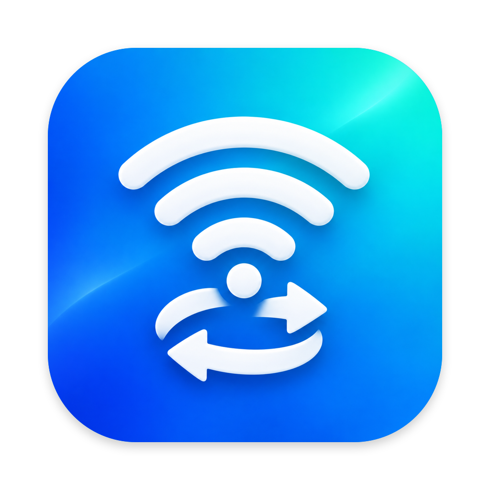

# 网络优先级



**Wi-Fi、有线、手机共享，今天谁上网？你说了算。**

一款 Mac 小应用，一键调整网络优先顺序，省得每次钻进系统设置。

**[下载 App](https://github.com/zhengsaihong/network-priority/releases/latest)** · macOS 13 及以上


## 安装

下载 DMG，打开后把 App 拖进「应用程序」。搞定。

## 使用

1. 连好要用的网络，打开 App。
2. 选择网络，点击「设为优先」。
3. 想换回来？再选一次就行。

只调整网络优先顺序，不会更换 Wi-Fi。记得先连好网络——它负责排队，不负责变出网线。

> 首次打开若被拦截：确认下载来源后，到「系统设置 → 隐私与安全性」按提示选择「仍要打开」。应用使用个人证书签名，暂未公证。

## 开发运行

在 Mac 上安装 Xcode 或 Command Line Tools（Swift 6+），然后在终端运行：

```sh
git clone https://github.com/zhengsaihong/network-priority.git
cd network-priority
OUTPUT_DIR="$PWD/.build/app" zsh build.sh
open ".build/app/网络优先级.app"
```

界面和网络逻辑在 `main.swift`，图标在 `assets/`。修改后先退出 App，再运行最后两条命令即可。生成的 App 在项目的 `.build/app/` 文件夹里。
